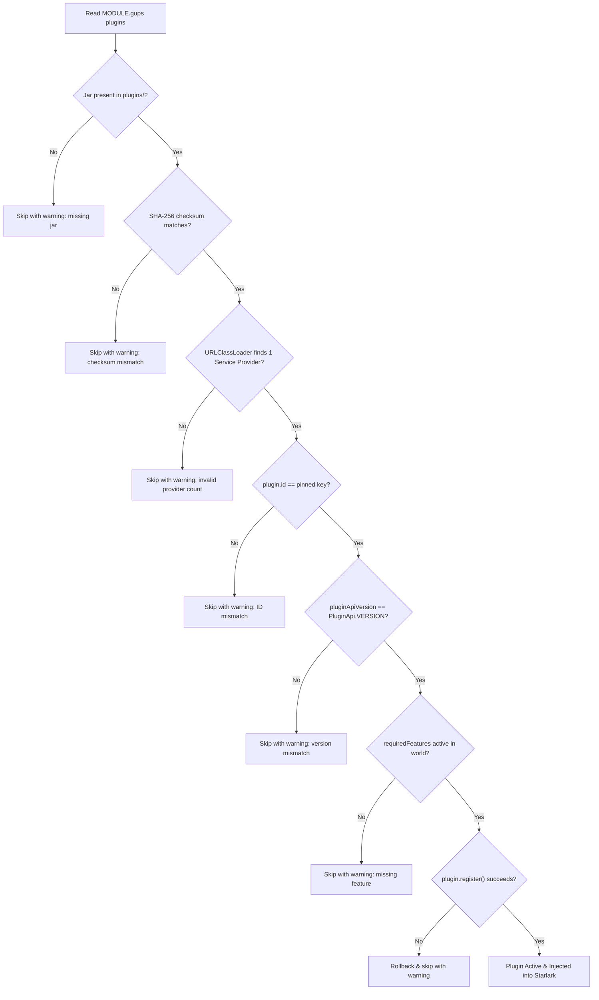

# 08. Packaging, Pinning, and Deployment

Once your plugin is implemented and passes all unit and integration tests, it is ready to be packaged, cryptographically
pinned, and deployed to a GUPS course world.

This tutorial explains how to build the `.jar` artifact, calculate its SHA-256 checksum, register it in `MODULE.gups`,
and review it against the engine security checklist.

---

## 1. Building the Plugin Jar

To compile the plugin and package the `.jar` bundle, run:

```bash
./gradlew :samples:weather-plugin:jar
```

The resulting jar artifact is placed in your project's build directory:

```text
samples/weather-plugin/build/libs/weather.jar
```

---

## 2. Calculating the Cryptographic Hash

For security and reproducibility, GUPS requires every plugin jar to be pinned by its SHA-256 cryptographic hash.

First, copy the built `.jar` into the `plugins/` directory of your course world repository:

```bash
mkdir -p plugins/
cp samples/weather-plugin/build/libs/weather.jar plugins/weather.jar
```

Next, compute the SHA-256 checksum using `shasum`:

```bash
shasum -a 256 plugins/weather.jar
```

This will print a 64-character hexadecimal digest, for example:

```text
e3b0c44298fc1c149afbf4c8996fb92427ae41e4649b934ca495991b7852b855  plugins/weather.jar
```

---

## 3. Registering the Plugin in `MODULE.gups`

Open the course world's `MODULE.gups` file and add the plugin to the `plugins` map:

```python
module(
    api_version=1,

    # Pin plugins by id and SHA-256 checksum:
    plugins={
        "weather": "sha256:e3b0c44298fc1c149afbf4c8996fb92427ae41e4649b934ca495991b7852b855",
    },
)
```

### Formatting Requirements

* The dictionary key must match the plugin's `id` property (`"weather"`).
* The value must be formatted as `"sha256:<64 lowercase hex digits>"`.

---

## 4. World Startup & Verification Pipeline

Whenever the engine starts (`gups serve`, `gups test`, `gups lint`, `gups fuzz`, or `gups docs --world`), it performs a
strict verification pipeline for every pinned plugin in alphabetical order:



### Safety Rules

* **Unpinned Jars are Ignored:** Any `.jar` file present in the `plugins/` directory that is not pinned in `MODULE.gups`
  is safely ignored with a warning:
  ```text
  warning: plugins/rogue.jar is not pinned in MODULE.gups; ignoring it
  ```
* **Atomic Rollback:** If any step of `register()` fails (such as an exception, invalid syntax, or command collision),
  the entire registration is aborted. The plugin adds nothing and the server continues starting without it.
* **Missing Plugin Consequences:** If a plugin is skipped, packages that reference its global namespace (e.g.
  `weather.now`) will fail to load with `name 'weather' is not defined`.

---

## 5. Trust and Security Model

A plugin is trusted code with full JVM access: **there is no Java security sandbox**. Plugins run directly within the
engine process to achieve native execution speeds and direct memory access.

Security in GUPS is maintained through strict procedural governance:

### 1. Instructor CODEOWNERS Gate

In the course world repository, `CODEOWNERS` restricts write access for `MODULE.gups` and `plugins/` strictly to course
instructors:

```text
/MODULE.gups @prof-smith
/plugins/    @prof-smith
```

Students can submit zone packages, but cannot install or modify plugins without instructor review and approval.

### 2. Mandatory Server Restarts

Plugins cannot be hot-reloaded. Deploying changes to `plugins/` or `MODULE.gups` requires a server restart; live deploys
(`gups deploy`) refuse any commit that touches these paths (SPEC §5.10).

### 3. Instructor Review Checklist

Before approving a new plugin or plugin upgrade, instructors verify:

* **Source Review:** Build the jar yourself from reviewed source code and pin the checksum of that build.
* **Clean Imports:** Confirm the plugin imports **only** `gups.pluginapi.*`, `net.starlark.java.*`, Kotlin, and standard
  JDK classes.
* **No Uncontrolled I/O:** Verify there are no file system reads/writes, arbitrary network sockets, process spawning, or
  reflective class loading.
* **Determinism:** Ensure all procedural algorithms derive state from `world.seed` and `world.pulse` rather than
  wall-clock timestamps (`System.currentTimeMillis()`) or unseeded random generators.
* **Fail Loudly:** Ensure invalid arguments throw informative exceptions rather than failing silently.

---

## 6. Engine Upgrades and Compatibility

GUPS makes **no binary compatibility guarantees** across engine releases:

* Any change to `gups.pluginapi` or the engine facade bumps `PluginApi.VERSION`.
* When the engine is upgraded, existing plugin jars must be recompiled against the new `:plugin-api` dependency and
  their new checksums re-pinned in `MODULE.gups`.

---

## Conclusion & Further Reading

Congratulations! You now know how to design, build, test, package, and deploy custom plugins for the GUPS engine.

For further reference, explore:

* **The Reference Plugin:** [`WeatherPlugin.kt`](../../src/main/kotlin/gups/sample/weather/WeatherPlugin.kt)
* **The Plugin Test Suite:** [`WeatherPluginTest.kt`](../../src/test/kotlin/gups/sample/weather/WeatherPluginTest.kt)
* **Engine Architecture Specification:** [`docs/SPEC.md`](../../../docs/SPEC.md) §4.15
* **Developer Reference Guide:** [`docs/PLUGINS.md`](../../../docs/PLUGINS.md)
