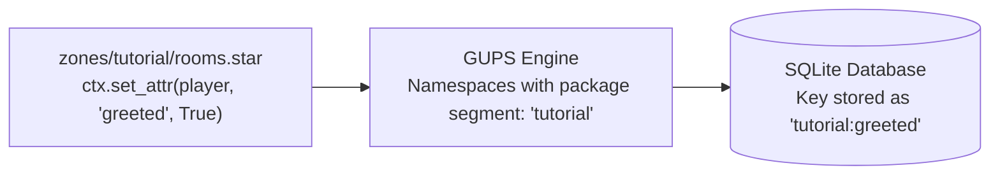

# 04. State, Attributes, and Persistence

In [`rooms.star`](../../zones/tutorial/rooms.star), you encounter this hook:

```python
def _hall_enter(ctx):
    if ctx.actor.is_player and not ctx.get_attr(ctx.actor, "greeted", False):
        ctx.set_attr(ctx.actor, "greeted", True)
        ctx.send(ctx.actor, greeting(ctx.actor.name))
        quest.start(ctx, ctx.actor, FIRST_STEPS)
```

This tutorial explains how custom state works in GUPS: why `greeted` is attached to the actor, how package namespacing
protects student packages from clashing, how data persists in SQLite, and how shared libraries manage global progress.

---

## 1. What are Attributes?

While the engine tracks core gameplay data (such as health, inventory, position, and stats) internally, scripts need a
way to store custom variables—such as quest progress, dialogue flags, puzzle states, or trap cooldowns.

In GUPS, custom state is stored as **attributes** on entities using the `ctx` API:

```python
# Read an attribute (returns default if not set)
value = ctx.get_attr(target_entity, "key", default=None)

# Write an attribute
ctx.set_attr(target_entity, "key", value)

# Delete an attribute
ctx.del_attr(target_entity, "key")
```

---

## 2. Entity Scoping: Actor vs. Room vs. Item

A common point of confusion is **where** state lives. Attributes are always attached to a **specific entity**, not to a
location:

### Actor-Attached State (`ctx.actor`)

In `_hall_enter`, the target is `ctx.actor`:

```python
ctx.set_attr(ctx.actor, "greeted", True)
```

* **Scope:** This attribute is bound to the player character.
* **Mobility:** If the player leaves `:hall`, travels to another zone, and returns later,
  `ctx.get_attr(ctx.actor, "greeted")` will still return `True`. The player is not greeted again.

### Room-Attached State (`ctx.self` or room)

If you want to track state on a location (for example, how many times a lever was pulled or whether a chest has been
looted), attach the attribute to the room:

```python
def _pull_lever(ctx):
    # ctx.self is the room where the command was executed
    times_pulled = ctx.get_attr(ctx.self, "lever_pulls", 0) + 1
    ctx.set_attr(ctx.self, "lever_pulls", times_pulled)
    ctx.send(ctx.actor, "You pull the lever (total pulls: %d)." % times_pulled)
```

### Item-Attached State

Items can store their own attributes (such as charges remaining on a magic wand):

```python
charges = ctx.get_attr(ctx.self, "charges", 3)
if charges > 0:
    ctx.set_attr(ctx.self, "charges", charges - 1)
```

---

## 3. Automatic Package Namespacing

In a course world, dozens of student teams create packages concurrently. If Team A and Team B both set an attribute
called `"ready"` on a player, they must not overwrite each other.

To solve this, the GUPS engine enforces **automatic attribute namespacing**:



### The Rules of Namespacing:

1. **Writing is strictly isolated:** A package can **only write its own namespace**. Calling
   `ctx.set_attr(actor, "other_zone:flag", True)` is a runtime script error.
2. **Short keys within your package:** Within package `zones/tutorial`, writing or reading `"greeted"` automatically
   resolves to `"tutorial:greeted"`.
3. **Cross-package reads require qualified keys:** If `zones/forest` wants to check if a player was greeted in the
   tutorial, it can read the fully-qualified key:
   ```python
   # Inside zones/forest:
   has_completed_tutorial = ctx.get_attr(ctx.actor, "tutorial:greeted", False)
   ```
   However, `zones/forest` can **never** modify or delete `"tutorial:greeted"`.

---

## 4. Persistence and Checkpoints

Where do attributes go, and do they survive a server restart?

```text
SQLite Database (.gups/world.db)
├── players table
│   └── payload_json: { "attrs": { "tutorial:greeted": true, "lib:quests": { ... } } }
└── world_entities table
    └── payload_json: { "attrs": { "tutorial:lever_pulls": 5 } }
```

* **Player Persistence:** Player attributes are serialized to the `players` table in SQLite. They survive logouts,
  link-dead disconnects, and server restarts. When the player logs in next week, their attributes are fully restored.
* **Room and Item Persistence:** Attributes set on rooms and items are serialized during scheduled world checkpoints
  (configured by `checkpoint_minutes` in `MODULE.gups`).
* **Allowed Data Types:** Attributes support primitive Starlark types:
    * `bool`, `int`, `float`, `str`
    * Lists and dictionaries of primitives
    * *Note:* You cannot store entity objects (e.g. `ctx.actor`), functions, or modules inside an attribute.

---

## 5. Shared Libraries and the Innermost Function Rule

Notice the next line in `_hall_enter`:

```python
quest.start(ctx, ctx.actor, FIRST_STEPS)
```

How does `//lib:quest.star` store quest progress without clashing with student zones?

In [`template-world/lib/quest.star`](../../lib/quest.star):

```python
def _save(ctx, actor, quests):
    ctx.set_attr(actor, "quests", quests)
```

### The Innermost Running Function Rule (SPEC §3.7)

At runtime, relative labels and attribute keys resolve against the package of the **innermost running function**:

* When `_hall_enter` (in `//zones/tutorial`) calls `quest.start(...)`, execution enters `_save` inside `//lib`.
* Because `_save` belongs to package `//lib`, the attribute write resolves to the `"lib"` namespace: `"lib:quests"`.
* This allows shared libraries to manage centralized game state safely on behalf of caller packages!

---

## 6. Built-in State vs. Attributes

Attributes are meant for script logic. Core game mechanics are built into the engine and must **not** be stored in
attributes:

| Game Concept  | How to Read / Modify                           | NOT Attributes                         |
|---------------|------------------------------------------------|----------------------------------------|
| Health / Mana | `ctx.heal()`, `ctx.damage()`, `actor.hp`       | `ctx.set_attr(actor, "hp", ...)` ❌    |
| Position      | `exit()`, `ctx.teleport()`                     | `ctx.set_attr(actor, "room", ...)` ❌  |
| Inventory     | `ctx.give()`, `ctx.take()`, `actor.has_item()` | `ctx.set_attr(actor, "items", ...)` ❌ |
| Stats         | `stat_deltas` on equipment, `actor.stats`      | `ctx.set_attr(actor, "str", ...)` ❌   |

---

## Reference Links

* **Reference Implementation:** [`template-world/zones/tutorial/rooms.star`](../../zones/tutorial/rooms.star#L32-L39)
  and [`template-world/lib/quest.star`](../../lib/quest.star)
* **Specification:** [SPEC.md §3.7: Attribute Namespacing](../../../docs/SPEC.md#L739)
  and [§3.6: Persistence Schema](../../../docs/SPEC.md#L698)
* **HTML Documentation:** `ctx.html#get_attr` and `ctx.html#set_attr` in `gups docs`.
